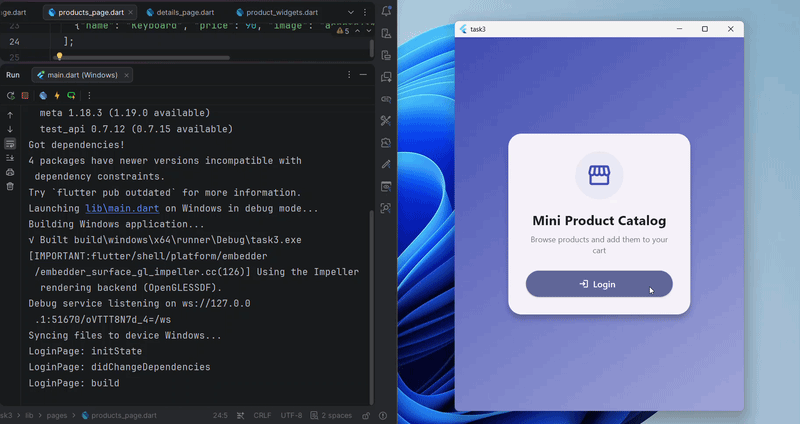

# Mobile-Application-Development-Tasks-

## Yasmeen Wael Abdelsabour
## 4 - BIO

<h1>TASK 1</h1>


---
<h1>TASK 2</h1>


----


<h1>TASK 3</h1>

A small Flutter app with 3 screens: **Login -> Products -> Product Details**.
Navigation is done with `Navigator` only (`pushNamed`, `push`, `pop`).




## Project structure

```
lib/
├── main.dart              # MyApp + named routes
├── product_widgets.dart   # helper widgets (list / grid / tile)
└── pages/
    ├── login_page.dart
    ├── products_page.dart
    └── details_page.dart
assets/
└── images/                # product images
```

## Features

- All 3 pages are `StatefulWidget`s and print their lifecycle methods
  (`initState`, `didChangeDependencies`, `build`, `deactivate`, `dispose`).
- Favorites counter updated with `setState`.
- Responsive layout: `ListView` when width < 600, `GridView` otherwise.
- `Navigator.pushNamed` sends the username `"Guest"` using `arguments`.
- Details page sends a result back with `Navigator.pop`, received with `await`.


## Part 1 - Lifecycle answers

**a) Which methods run when a page opens for the first time?**
`initState` -> `didChangeDependencies` -> `build`.

**b) Which method runs again after pressing the heart button?**
Only `build`, because `setState` marks the widget as dirty and Flutter rebuilds it.

**c) Which methods run when you leave a page and go back?**
- Products -> Details (`push`): Details runs `initState` -> `didChangeDependencies` -> `build`.
  Products is **not** disposed (it stays in the navigator stack, so no `deactivate` or `dispose`),
  but it runs `didChangeDependencies` -> `build` once, because it reads `ModalRoute.of(context)`
  and its route is no longer the current one.
- Details -> Products (`pop`): Products runs `didChangeDependencies` -> `build` again
  (it is the current route again, and this rebuild also shows the cart message from `setState`).
  Then Details runs `deactivate` -> `dispose` when the transition ends.
- Login stays in the stack under Products, so it prints nothing after the first time.

**d) Which methods run when you resize the browser window, and why?**
`didChangeDependencies` and then `build`. The page reads `MediaQuery.sizeOf(context)`,
so it depends on `MediaQuery`. When the window size changes, that dependency changes,
so Flutter calls `didChangeDependencies` and rebuilds the page.

## Console output (lifecycle prints)

```
LoginPage: initState
LoginPage: didChangeDependencies
LoginPage: build
ProductsPage: initState
ProductsPage: didChangeDependencies -> width: 528.0, height: 682.4
ProductsPage: build
ProductsPage: build                      <- heart button (setState)
DetailsPage: initState
DetailsPage: didChangeDependencies
DetailsPage: build
ProductsPage: didChangeDependencies -> width: 528.0, height: 682.4
ProductsPage: build                      <- Details pushed on top
ProductsPage: didChangeDependencies -> width: 528.0, height: 682.4
ProductsPage: build                      <- Add to Cart (pop + setState)
DetailsPage: deactivate
DetailsPage: dispose
ProductsPage: didChangeDependencies -> width: 530.4, height: 682.4
ProductsPage: build                      <- window resized
ProductsPage: didChangeDependencies -> width: 556.8, height: 682.4
ProductsPage: build                      <- window resized
```
